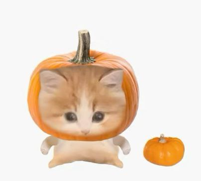

# 👋 Добро пожаловать на Сайт Марии!

Привет!  
Рада видеть тебя здесь 🌸  

Это мой личный сайт, созданный в рамках дисциплины **"Введение в веб-технологии"**.  
Здесь я экспериментирую, создаю, изучаю, иногда — лома́ю (но чиню потом!) 😅  

---

## 🌈 О чём этот сайт?

- Немного обо мне  
- Примеры моих проектов  
- Контактная информация  
- И, возможно, чуточку вдохновения

---

> _“Лучший способ понять, как работает веб — создать свой собственный сайт.”_  
> — кто-то мудрый (возможно, преподаватель 😉)

---

_Да, логотип временный. Но котики — вечно._
