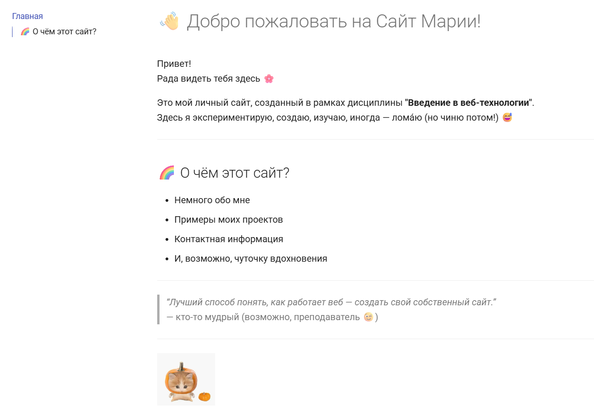
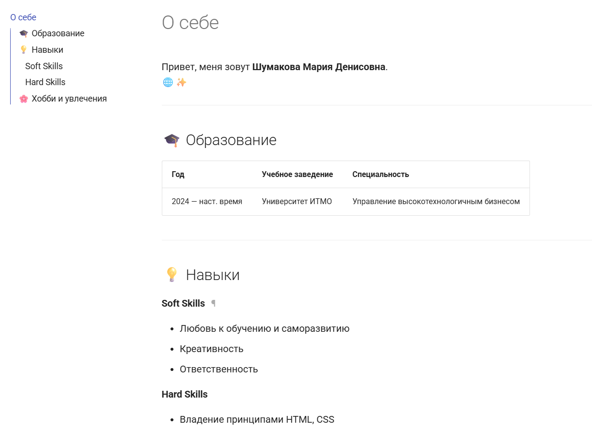
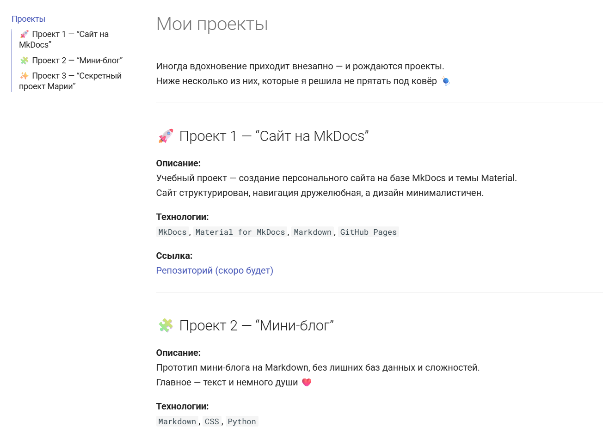
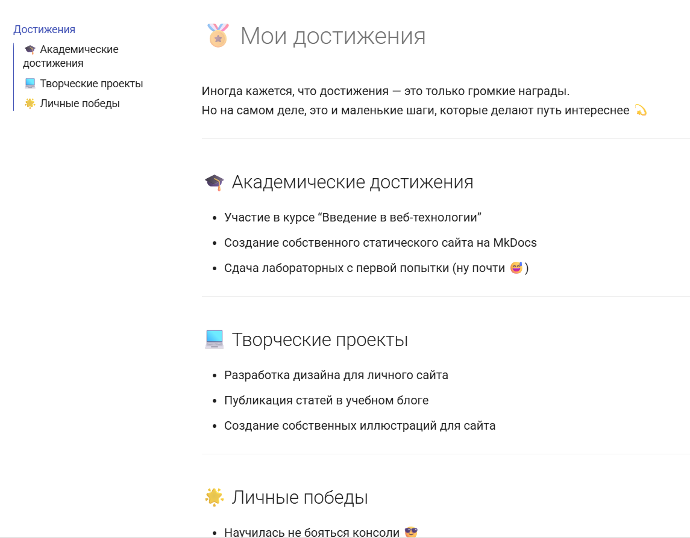
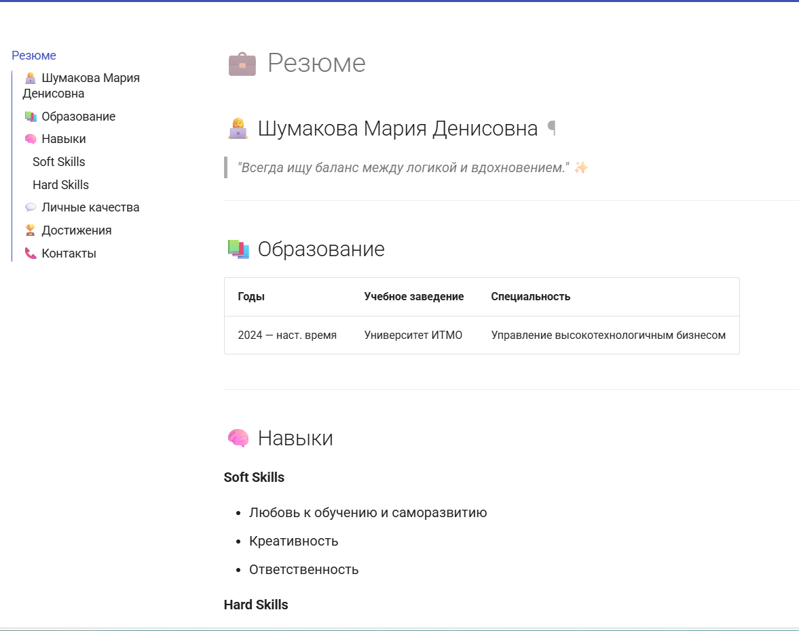
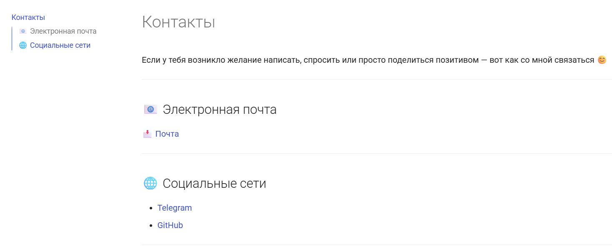
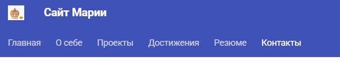
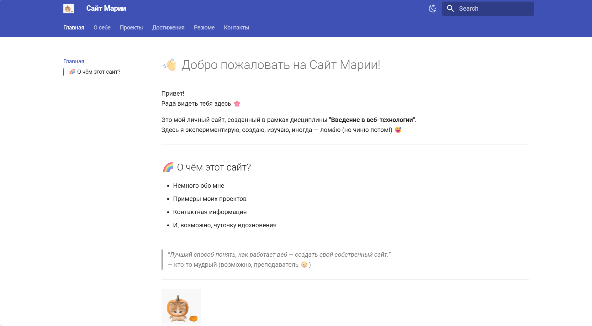
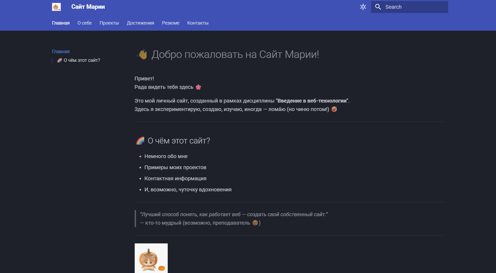
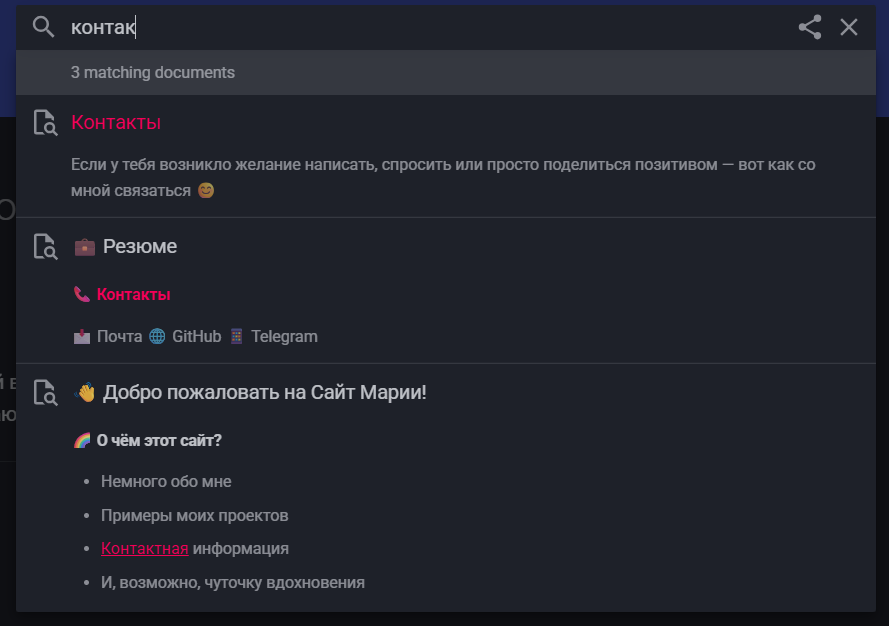

# Отчет по курсовой работе

University: ITMO University  
Faculty: FTMI  
Course: introduction-in-web-tech  
Year: 2025/2026  
Group: U4225  
Author: Shumakova Maria  
Lab: CourseWork  
Date of create: 12.10.2025  
Date of finished: 13.10.2025

---

Используя MkDocs и язык разметки Markdown я создала свой персональный сайт. Далее пройдемся по его содержимому

## Инструменты

- Python
- MkDocs
- Markdown
- Material Icons / Themes

## Конфигурация

Конфигурация сайта, разделы, навигация, темы, поиск и т.д. прописаны в файле [mkdocs.yml](./mkdocs.yml)

## Запуск

```bash
git clone https://github.com/Maria144-dev/devops-lab-shumakova.git
cd ./devops-lab-shumakova/courve_work/my_personal_site
mkdocs serve
```

Перейти на [http://localhost:8000/](http://localhost:8000/)

## Разделы сайта

На сайте представлены следующие страницы

### Главная ([index.md](./docs/index.md))



### О себе ([about.md](./docs/about.md))



## Проекты ([projects.md](./docs/projects.md))



## Достижения ([achievements.md](./docs/achievements.md))



## Резюме ([resume.md](./docs/resume.md))



## Контакты ([contacts.md](./docs/contacts.md))



## Основные блоки

Сайт имеет постраничкую навигацию, логотип и название



Кнопку переключения темы на светлую/темную



Активный и работающий поиск



