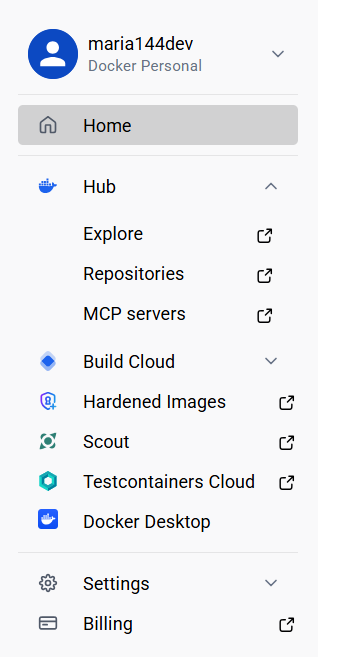
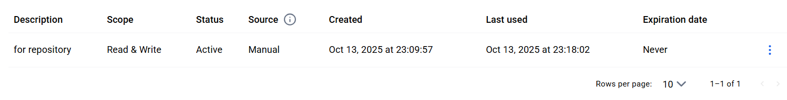
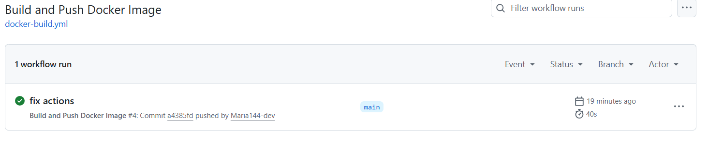
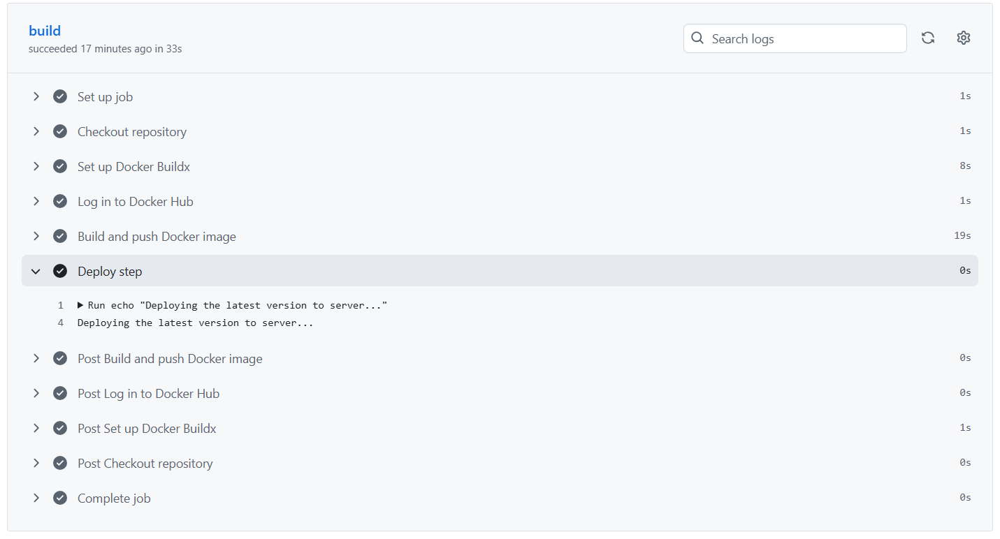
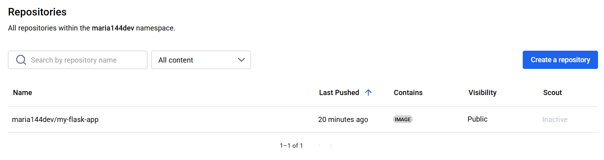

# Отчет по лабораторной №2

University: ITMO University  
Faculty: FTMI  
Course: introduction-in-web-tech  
Year: 2025/2026  
Group: U4225  
Author: Shumakova Maria  
Lab: Lab2  
Date of create: 13.10.2025
Date of finished: 13.10.2025

---
### Шаги выполнения

Вместо создания нового репозитория проведем работу в текущем. Скопируем файлы `app.py`, `requirements.txt`, `Dockerfile` из [репозитория](https://github.com/itmo-ict-faculty/introduction-in-web-tech/tree/main/examples/lab1)

Создадим аккаунт в [Docker Hub](https://app.docker.com/)

Далее сразу же создадим accessKey для репозитория. Он понадобится позже

Создадим директорию .github/workflow для github Actions, создадим в нем файл [docker-build.yml](../.github/workflows/docker-build.yml). Установим пайплайн для поочередного выполнения шагов:

- Запускаться при пуше в main ветку
- Использовать Ubuntu как runner
- Выполнять checkout кода
- Настраивать Docker Buildx
- Логиниться в Docker Hub используя секреты
- Собирать и пушить образ с тегом username/my-flask-app:latest
- Добавлять шаг деплоя (можно просто echo сообщение)

В репозитории переходим по пути:
`Settings → Secrets and variables → Actions → New repository secret`. Добавляем 2 секрета:

- `DOCKERHUB_USERNAME` - логин в Docker Hub
- `DOCKERHUB_TOKEN` - AccessToken из Docker Hub, который мы создали ранее

Пушим изменения в main и смотрим на вкладку [actions](https://github.com/Maria144-dev/devops-lab-shumakova/actions/). Там появился процесс билда (который позже прошел успешно)

Можно глянуть логи и посмотреть, что нам вывелось сообщение после успешного прохождения всех шагов

Остается только перейти назад в Docker Hub и убелиться, что репозиторий создался успешно

