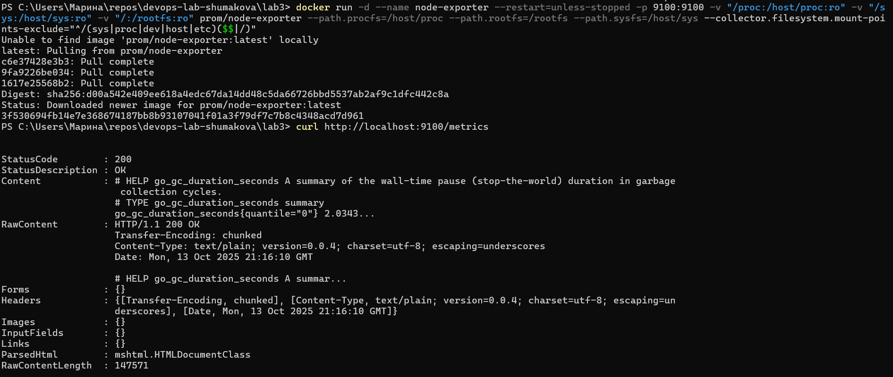
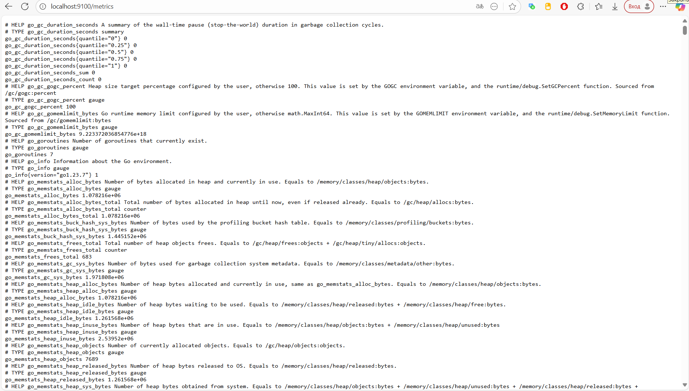
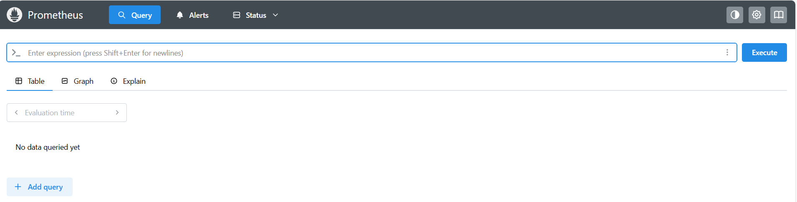
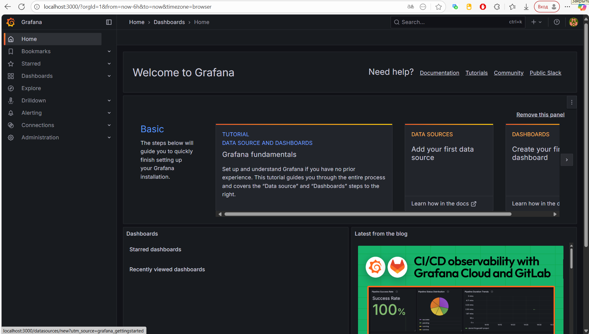
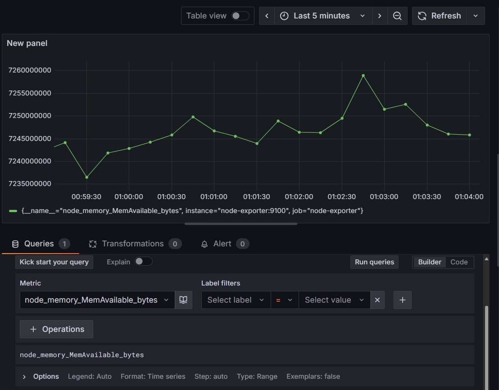
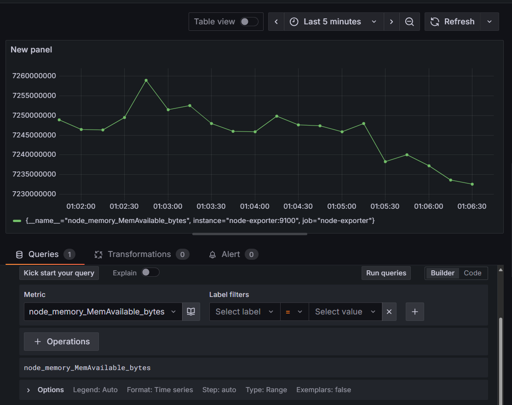
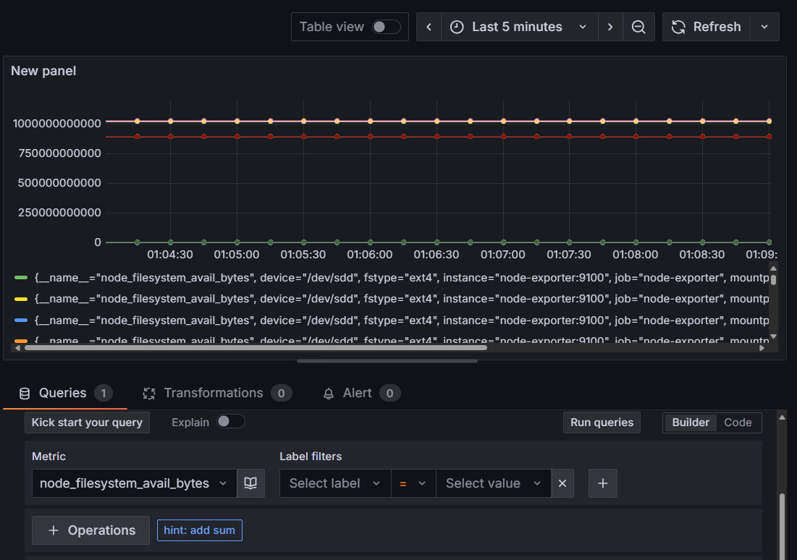

# Отчет по лабораторной №3

University: ITMO University  
Faculty: FTMI  
Course: introduction-in-web-tech  
Year: 2025/2026  
Group: U4225  
Author: Shumakova Maria  
Lab: Lab3  
Date of create: 14.10.2025  
Date of finished: 14.10.2025

---
### Шаги выполнения

Создай файл [prometheus/prometheus.yml](./prometheus/prometheus.yml), в котором:

- `scrape_interval: 15s` — Prometheus будет собирать метрики каждые 15 секунд
- `job_name` — имя задачи (Prometheus и Node Exporter)
- `targets` — адреса, откуда собираются метрики

Запустим контейнер Node Exporter для сбора системных метрик и проверим его работоспособность



Если перейти на [http://localhost:9100/metrics](http://localhost:9100/metrics), то можно увидеть что-то подобное



Создаем том для данных Prometheus и запускаем контейнер. Проверяем работоспособность, перейдя на [http://localhost:9090](http://localhost:9090)



Аналогично создать том для данных Grafana и запускаем контейнер. Проверяем работоспособность, перейдя на [http://localhost:3000](http://localhost:3000). Логинимся как admin



> На данном этапе при Добавлении источника данных Prometheus возникала ошибка - контейнеры не видели друг друга. Создадим общую сеть и немного видоизменим команды запуска контейнеров.

```bash
docker network create monitoring-net
```

После этого получаем работоспособный API


Построим несколько графиков за последние 5 минут (т.к. статистика еще не набралась):

`node_memory_MemAvailable_bytes` - свободная память



`node_cpu_seconds_total` - загрузка процессора



`node_filesystem_avail_bytes` - свободное место на диске




